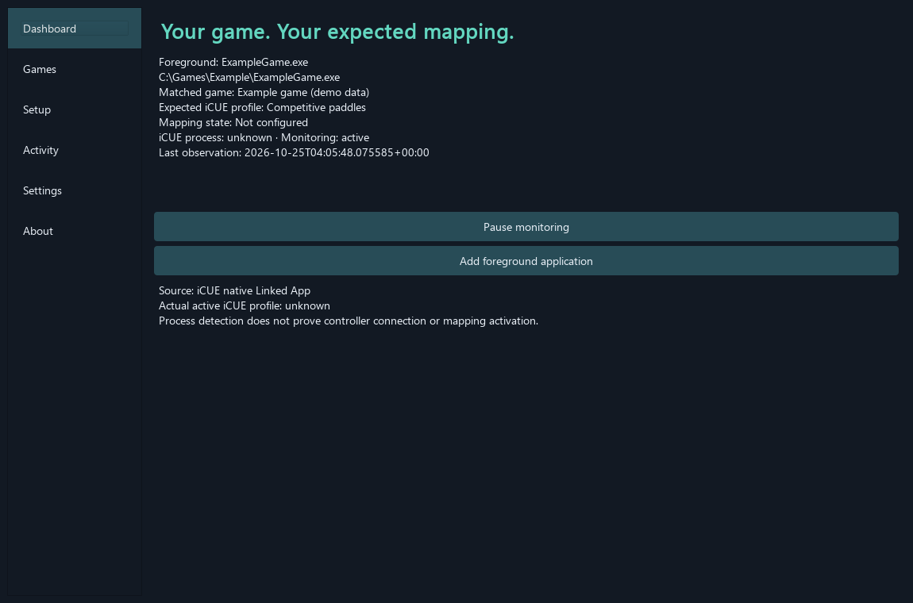
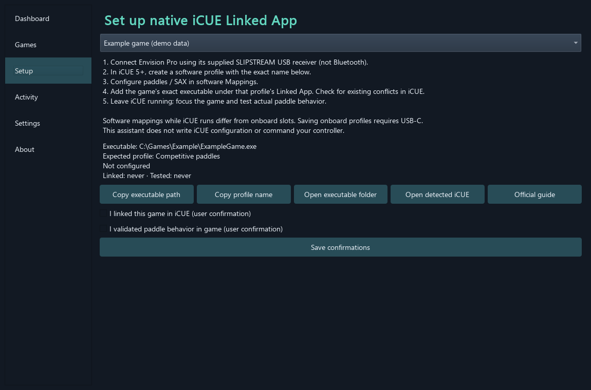

# SCUF Automatic Mapping

A local Windows desktop companion that recognizes your foreground game, organizes
its expected SCUF Envision Pro software mapping, and guides you through **iCUE's
native Linked App** setup. Version **0.1.0**.

**iCUE performs the switching.** This application never writes iCUE's private files,
commands hardware slots, or claims to know the active iCUE profile. It keeps four
things separate: expected profile, user-confirmed link, user-confirmed in-game
test, and actual activation (**unknown**).

**Hardware acceptance: NOT YET VERIFIED.** Requires Windows hardware validation
with iCUE and an actual SCUF Envision Pro. Automated results are documented in
[IMPLEMENTATION_REPORT.md](IMPLEMENTATION_REPORT.md).



The screenshot is rendered from the actual application using synthetic demo data;
it is not evidence of a connected controller or successful hardware switching.

## What you can do

- Watch foreground game detection, expected profile, iCUE process presence, and
  your confirmation state on the dashboard.
- Add, edit, delete, disable, search, and sort game mappings. Match exact Windows
  executable paths first, then unambiguous basenames. Conflicts never guess.
- Browse trusted game executables, use the observed foreground application, or
  discover running processes with best-effort paths and a filter.
- Follow the Setup guide, copy executable/profile details, and record dated
  confirmations of the manual iCUE link and actual paddle testing.
- Import/export schema-versioned JSON with validation, conflict preview, explicit
  duplicate-ID handling, atomic writes, and a pre-import database backup.
- Pause monitoring, optionally minimize to tray, enable quiet opt-in notifications,
  and opt into current-user Windows login startup in packaged builds.
- Search retained local events, back up the database, and export diagnostics with
  home-directory redaction by default.

No accounts, telemetry, automatic downloads, admin privileges, hooks, drivers,
game memory reads, input simulation, or network services. Optional official help
links open your browser only when clicked. iCUE may have its own network behavior.

## Requirements and download

- Windows 10/11 x64; SCUF Envision Pro and Corsair iCUE 5+ for actual controller use.
- Wireless uses the **supplied SLIPSTREAM USB receiver**, not Bluetooth. USB-C is
  required for saving onboard mappings; those slots are outside this app's scope.
- Python 3.11+ for development; this implementation was tested with Python 3.13.4.
- The portable packaged application does not require a separate Python install.

Get the Windows artifact from [GitHub Actions](https://github.com/subhan-mehmood-03/Scuf-Controller-Automatic-Mapping/actions):
open a successful **Test and package** run, download
`SCUF-Automatic-Mapping-Windows`, unzip, and run `SCUF-Automatic-Mapping.exe`.
GitHub may require sign-in to download artifacts. No tagged release is published.
Builds are unsigned; no signing certificate or updater is included.

## Run from source (PowerShell)

From the repository root:

```powershell
py -3 -m venv .venv
.\.venv\Scripts\Activate.ps1
python -m pip install --upgrade pip
python -m pip install -e ".[dev]"
python -m scuf_auto_mapping
```

If activation is blocked by your execution policy, use
`.\.venv\Scripts\python.exe` in place of `python`; changing machine policy is
unnecessary. Dependency versions are constrained in `pyproject.toml`.

## Configure two games

1. Open iCUE and ensure it recognizes your controller. Download iCUE manually from
   the official page linked in Settings if needed.
2. Open **Games → Add**. Select the actual game `.exe`, not its launcher. Enter a
   recognizable game name and exact intended iCUE software profile name.
3. In **Setup**, select the game. In iCUE create that software profile, configure
   paddles/SAX under software Mappings, and set **Linked App** to the exact game
   executable. Copy buttons help avoid transcription mistakes.
4. Check **I linked this game in iCUE**, then save confirmations. This is your
   attestation, not an automatic configuration write.
5. Keep iCUE running, focus the game, and physically test paddle behavior. Only
   after this test check **I validated paddle behavior in game** and save.
6. Repeat for a second game with visibly different mappings. Switch games and
   confirm both the dashboard's expected profile and actual in-game behavior.



The app waits for two consecutive foreground observations (about 1–2 seconds at
the default 1000 ms interval). A focus change does not send any controller command.
Editing an executable identity or expected profile clears old attestations.
The dashboard never treats iCUE process presence as controller readiness.

For unmatched apps, the app shows **No game mapping**. The optional default profile
setting is a reminder; configure any actual fallback behavior manually in iCUE.
Duplicate basename fallback or duplicate exact paths are conflicts; resolve the
records in Games. External iCUE conflicts cannot be inspected by this app.

## Data, backups, privacy, and uninstall

Data lives in `%LOCALAPPDATA%\SCUFAutomaticMapping\`, independent of the EXE's
location. `profiles.db` stores profiles, settings, and bounded events. Local logs
rotate through at most five files of 2 MB each. Events are capped at 30 days and
5000 entries; settings may reduce these limits.

- Use **Games → Export** for portable profile JSON. This export intentionally
  contains executable paths and notes: treat it as personal data. Settings and
  events are not in profile JSON.
- Imports are limited to 5 MB / 10000 records per file. Preview and choose whether
  existing IDs are replaced or skipped. Different IDs with duplicate paths remain
  visible conflicts. A `profiles.pre-import.db` backup is made before each import.
- Use **Settings → Back up database** for a complete SQLite backup. With the app
  fully exited, preserve your existing database and copy a known-good backup to
  `profiles.db` to restore it. Relaunch afterward.
- Corruption triggers an explicit recovery prompt. Original bytes are preserved
  as `profiles.unreadable*.db`; declining leaves the database untouched. Accepting
  starts a new database at the normal location. Do not delete preserved files
  until recovery is complete.
- **Activity → Export diagnostics** redacts home-directory/user names by default.
  The raw-path checkbox is explicit opt-in. Review exports before sharing; game
  names and your custom profile names may remain. Local logs are not uploaded.
- Autostart defaults off and uses only
  `HKCU\Software\Microsoft\Windows\CurrentVersion\Run\SCUFAutomaticMapping`.
  It is disabled in development. Keep the packaged EXE in a stable trusted folder.
  Moving the EXE requires disabling/re-enabling autostart.
- To uninstall, disable autostart in Settings, exit through the tray menu, and
  remove the portable EXE. Optionally remove the LocalAppData directory to delete
  personal data. If the EXE is already removed, delete only the named Run value
  through Windows Registry Editor. No driver/service cleanup is needed.

Closing exits normally unless you explicitly enabled minimize-to-tray. When the
tray is unsupported, Close always exits. A second instance is rejected using a
local instance lock. Tray menu actions restore, pause/resume, and exit.

## Test and build

```powershell
python -m pytest -q --cov --cov-report=term-missing
python -m ruff check .
python -m mypy src
python -m scuf_auto_mapping --self-test
```

For headless GUI tests, set `$env:QT_QPA_PLATFORM = 'offscreen'` before pytest.
The platform adapter has mocked failure tests and a separate Windows read-only
query test; non-Windows CI skips only that live query. Pure library and GUI tests
run on Linux as well. Coverage excludes the ctypes Win32 wrapper from its numeric
threshold because a synthetic call test cannot prove desktop OS behavior; it is
still exercised by adapter and live Windows tests.

Build a portable Windows EXE after installing development dependencies:

```powershell
powershell -ExecutionPolicy Bypass -File .\scripts\build_windows.ps1
```

The script runs PyInstaller, the isolated persistence/import `--self-test`, and an
isolated `--gui-smoke` that opens/closes the actual UI with temporary data. Output:
`dist/SCUF-Automatic-Mapping.exe`. Build outputs and personal runtime data are
excluded from Git. The script uses your currently selected `python`; activate the
virtual environment first. Building and downloading dependencies requires internet;
normal application operation is offline.

CI runs lint, type checks, unit/GUI coverage checks on Ubuntu and Windows, then
builds and smoke-tests the Windows EXE and uploads an artifact. No workflow
publishes releases or changes repository settings.

## Troubleshooting and limits

| Symptom | Action |
|---|---|
| Expected mapping appears but paddles do not change | Check the actual iCUE software profile, exact Linked App EXE, conflicting links, and controller recognition. Detection alone is not activation proof. |
| Foreground is unknown/inaccessible | Protected processes, UAC desktops, and exiting games may deny query access. The app does not elevate or bypass protection. Try discovery or select the EXE manually. |
| A launcher is detected | Wait until the game itself is foreground, or select its installed executable. |
| iCUE is running but presence says not detected | Review its real process basename and the Settings allowlist; presence still cannot prove connection. Open iCUE manually if its detected path is unavailable. |
| Detection seems delayed | Two-sample debounce is deliberate; interval is configurable from 250–10000 ms. |
| No popup | Notifications default off; only changed game matches notify, with a 10-second rate limit and same-game return suppression. Unmatched/system apps do not notify. |
| No autostart in development | Use the packaged EXE. No implicit Python or shell launch command is registered. |
| Import rejected | Use schema version 1, valid UUIDs, `.exe` basenames, absolute paths if provided, booleans, and timezone-aware ISO timestamps. Remove duplicate IDs and stay within payload limits. |
| Hardware is disconnected | The app cannot query controller readiness. Check iCUE directly. |

CPU target (<1% idle) is hardware-dependent and remains an acceptance measurement.
This version has no verified official iCUE activation/read API. Onboard profile
switching, macros/input automation, installers, code signing, and auto-updating
are outside scope. Physical game behavior, reboot autostart, and operation on a
machine without Python require the [hardware checklist](docs/HARDWARE_ACCEPTANCE.md).

## Architecture and sources

`domain/` owns validation/matching; `application/` owns debounce transitions;
`infrastructure/` owns SQLite, JSON, process queries, registry, and privacy;
`ui/` uses Qt signals from an interruptible worker and keeps SQLite on the UI
thread. Foreground observations are query-only; full process enumeration occurs
on demand or every ten seconds for iCUE presence, not every foreground poll.

The authoritative [PRD](docs/PRD.md) is preserved. Official references checked at
implementation time:

- [Corsair: profiles and Linked App](https://help.corsair.com/hc/en-us/articles/360058672092-iCUE-How-to-Set-up-and-manage-profiles-in-iCUE-4-or-newer)
- [SCUF Envision manual and connectivity](https://www.scufgaming.com/us/en/gaming/products/pc/envision/)
- [SCUF: software mappings](https://customercare.scufgaming.com/hc/en-us/articles/23528201411853-How-to-Software-Remap-in-iCUE-for-SCUF-Envision)
- [SCUF: hardware mappings](https://customercare.scufgaming.com/hc/en-us/articles/23530811859085-How-to-Hardware-Remap-Save-Profiles-in-iCUE-on-Envision)

Independent project, not affiliated with SCUF/Corsair. **All rights reserved**, as
requested by the repository owner. See [LICENSE](LICENSE). Dependencies retain
their own licenses; review Qt/PySide6 redistribution obligations before distribution.
